# Tarea individual U2 · Modelo híbrido PostgreSQL + MongoDB

**Estudiante:** Yostin Sisalema  **N.º de lista:** 6  **Caso:** 6 · Restaurante

> Mismo formato que el workload del material de Modelado (lección 2.2) y que el ejemplo resuelto de la clínica
> (`docs/ejemplo_clinica/Workload_clinica_hibrida.md`). Cada operación agrega la fila **Base**.

## 1. Workload

### 1.1 Casos de uso
- Un restaurante atiende comensales tanto en **mesa** como a **domicilio**; los usuarios se registran e inician sesión con JWT para gestionar sus pedidos y calificaciones.
- Los clientes y meseros consultan el catálogo semanal de platos (`Dish`), filtrando por texto, categoría, ingredientes o alérgenos.
- Un cliente autenticado realiza un **pedido** (`Order`) en mesa o a domicilio seleccionando un plato y cantidad; el sistema valida el plato en el catálogo y calcula el **total exacto** en PostgreSQL.
- Los clientes consultan su historial de pedidos enriquecido con los datos del plato correspondiente.
- Después de recibir el pedido, el cliente registra una **calificación del pedido** (`OrderRating`: puntaje 1–5, comentario, etiquetas) —máximo una calificación por pedido.
- Los visitantes y clientes consultan las calificaciones recientes de cada plato junto con el promedio y conteo total.
- El administrador/chef crea, edita y elimina platos del menú que cambia cada semana, sin eliminar platos referenciados por pedidos existentes.

### 1.2 Datos principales (cuántos actores, cuántos registros, cuánto tiempo se guardan)
- Clientes registrados (`User`): ~2 500 (crecen ~150 por mes).
- Platos en el catálogo (`Dish`): ~45 platos activos por menú semanal (~400 acumulados al año por rotación semanal).
- Pedidos (`Order`): ~400 por día (~12 000 por mes).
- Calificaciones de pedidos (`OrderRating`): ~180 por día (~45% de los pedidos). **Crecen sin límite.**
- Período de retención: los pedidos se conservan 5 años (contabilidad y facturación) y las calificaciones se conservan de forma histórica indefinida.

### 1.3 Suposiciones (lo que puede cambiar)
- El menú cambia cada semana (nuevos platos, ajuste de precios, ingredientes y alérgenos), por lo que un pedido debe congelar su `unitPrice` y `total` exacto al momento de crearse.
- Un pedido tiene como máximo **una** calificación (índice único en `orderId`).
- El nombre del cliente (`customerName`) y el tipo de servicio (`serviceType`: `MESA` o `DOMICILIO`) no cambian una vez emitido el pedido, por lo que pueden copiarse en la calificación para leer reseñas sin consultar PostgreSQL.
- El catálogo de platos tiene atributos variables según la receta (lista de ingredientes, alérgenos, categoría, tiempo de preparación).
- Las calificaciones se consultan principalmente por plato, ordenadas de la más reciente a la más antigua, junto con su promedio y total.

### 1.4 Operaciones (mínimo 6, una tabla por operación)

| Actor: | Cliente / Visitante |
|---|---|
| Descripción: | Consulta el menú semanal activo con búsqueda por texto, proyección de campos y ordenamiento |
| Tipo de operación: | Lectura |
| Datos en la operación: | `name`, `code`, `category`, `price`, `ingredients[]`, `allergens[]`, `available`, `prepMinutes` |
| Frecuencia: | En cada visita a la carta digital o toma de orden |
| Tasa: | ~5 000 / día |
| Base: | **MongoDB** (documento completo con ingredientes y alérgenos listo para mostrar en una sola lectura) |

| Actor: | Cliente (autenticado con JWT) |
|---|---|
| Descripción: | Crea un pedido (en mesa o a domicilio) eligiendo un plato del menú y calculando el total exacto |
| Tipo de operación: | Escritura |
| Datos en la operación: | `userId` (JWT), `dishId`, `serviceType` (`MESA`/`DOMICILIO`), `tableNumber` o `deliveryAddress`, `quantity`, `unitPrice`, `total`, `status` |
| Frecuencia: | ~400 por día, con picos en almuerzo (12:00–14:30) y cena (19:00–22:00) |
| Tasa: | 400 / día |
| Base: | **PostgreSQL** (integridad transaccional y precisión decimal del total); lee **MongoDB** para validar `dishId` y obtener el precio vigente |

| Actor: | Cliente (autenticado con JWT) |
|---|---|
| Descripción: | Consulta su historial de pedidos con el nombre, código y categoría del plato |
| Tipo de operación: | Lectura |
| Datos en la operación: | Pedidos (`Order`) de PostgreSQL + `name`, `code`, `category`, `allergens` de MongoDB |
| Frecuencia: | Cada cliente activo consulta sus pedidos recientes |
| Tasa: | ~1 200 / día |
| Base: | **Las dos**: se une en el servicio con `$in` + `Map` (2 consultas, sin N+1) |

| Actor: | Cliente (autenticado con JWT) |
|---|---|
| Descripción: | Registra la calificación de su pedido (máximo una calificación por pedido) |
| Tipo de operación: | Escritura |
| Datos en la operación: | `orderId`, `rating` (1–5), `comment`, `tags[]`; `userId` del JWT; `customerName` y `serviceType` copiados de PostgreSQL; `dish` (`ObjectId`) |
| Frecuencia: | ~45% de los pedidos completados |
| Tasa: | ~180 / día (~65 000 / año, crecimiento sin límite) |
| Base: | **MongoDB**, colección aparte; lee **PostgreSQL** para validar que el pedido exista (404) y pertenezca al usuario del token (403) |

| Actor: | Cliente / Visitante |
|---|---|
| Descripción: | Consulta las calificaciones de un plato (con datos del plato) y sus métricas agregadas (promedio y total) |
| Tipo de operación: | Lectura |
| Datos en la operación: | `customerName`, `serviceType`, `rating`, `comment`, `tags[]`, `dish` (populate), `createdAt`; promedio y conteo (`aggregate`) |
| Frecuencia: | Al revisar detalles de un plato antes de ordenar |
| Tasa: | ~2 500 / día |
| Base: | **MongoDB** solamente (gracias a copiar `customerName` y `serviceType`, evita consultar PostgreSQL) |

| Actor: | Administrador / Chef (autenticado con JWT) |
|---|---|
| Descripción: | Crea o actualiza un plato del menú semanal (precio, ingredientes, alérgenos, disponibilidad) |
| Tipo de operación: | Escritura |
| Datos en la operación: | Todos los campos del documento `Dish` |
| Frecuencia: | Al planificar o ajustar el menú semanal |
| Tasa: | ~15 / semana |
| Base: | **MongoDB** (esquema flexible para actualizar arreglos de ingredientes y alérgenos) |

| Actor: | Administrador (autenticado con JWT) |
|---|---|
| Descripción: | Elimina un plato del catálogo validando que no esté en uso por pedidos |
| Tipo de operación: | Escritura |
| Datos en la operación: | `_id` del plato; conteo de pedidos en PostgreSQL con ese `dishId` |
| Frecuencia: | Al depurar platos obsoletos sin historial de ventas |
| Tasa: | ~2 / mes |
| Base: | **MongoDB**, revisando **PostgreSQL** (`409` si existen pedidos que lo usan; si no, elimina en cascada sus calificaciones en MongoDB) |

### 1.5 Entidades

- **PostgreSQL**
  - `User`
    - `Order` (1:N, FK `userId`)
- **MongoDB**
  - `Dish`
    - `ingredients[]` (embebido)
    - `allergens[]` (embebido)
    - `OrderRating` (1:N, `dish` `ObjectId` + `ref: "Dish"`)
  - `OrderRating`
    - `tags[]` (embebido)
- **Entre bases (sin FK)**
  - `Order.dishId` → `Dish._id` (`String?`, 24 caracteres hex)
  - `OrderRating.orderId` → `Order.id` (`Number`, índice único)
  - `OrderRating.userId` → `User.id` (`Number`) · `OrderRating.customerName` y `OrderRating.serviceType` (copias)

### 1.6 Observaciones (qué domina: lectura o escritura, qué crece sin límite, qué necesita integridad)
- **Domina la lectura (~15:1):** hay ~8 700 lecturas diarias frente a ~580 escrituras diarias, concentradas en la consulta del menú semanal y reseñas; por eso el catálogo (`Dish`) y las calificaciones (`OrderRating`) se diseñan para resolverse en lecturas directas en MongoDB.
- **Crecimiento sin límite:** `OrderRating` crece de forma indefinida con cada pedido calificado; debe vivir en su propia colección y nunca embebida dentro de `Dish` (límite BSON de 16 MB).
- **Integridad estricta:** `Order` requiere precisión decimal exacta (`Decimal(10,2)`) para `unitPrice` y `total`, relación fuerte con `User` y transacciones ACID para evitar inconsistencias de cobro.
- **Índices derivados del workload:** `Order.dishId` (`@@index([dishId])` en PostgreSQL para `DELETE` protegido y reportes), `OrderRating.orderId` (`unique: true` en MongoDB para garantizar 1 calificación por pedido → `409`), y `OrderRating { dish: 1, createdAt: -1 }` en MongoDB para listar reseñas recientes por plato.

## 2. ¿PostgreSQL o MongoDB?

| Entidad | ¿Transacciones o choques? | ¿Otras dependen por FK? | ¿Forma variable? | ¿Crece sin límite? | ¿Se lee mucho más? | Base |
|---|---|---|---|---|---|---|
| **`User`** | Sí (registro único por email y autenticación) | Sí (`Order.userId` depende de `User.id`) | No (estructura fija) | No (crecimiento moderado) | Sí (login y validación) | **PostgreSQL** |
| **`Order`** | **Sí** (cálculo exacto de total, estado del pedido y facturación ACID) | Sí (`userId` FK hacia `User`) | No (campos fijos de mesa/domicilio y montos decimales) | Moderado/constante (archivable por año fiscal) | Equilibrado (creación, cambios de estado y consulta) | **PostgreSQL** |
| **`Dish`** | No (cambios semanales aislados por documento) | No en PG (solo referencia lógica `String?` en `Order`) | **Sí** (recetas cambian cada semana: ingredientes[], alérgenos[], categoría) | No (~45 activos, catálogo acotado) | **Sí** (~98% lecturas en carta digital) | **MongoDB** |
| **`OrderRating`** | No (una reseña no afecta el cobro del pedido) | No (referencia lógica a `orderId` y `userId`) | **Sí** (comentario opcional, etiquetas[] variables) | **Sí** (crecimiento continuo e ilimitado) | Sí (~2 500 lecturas/día vs ~180 escrituras/día) | **MongoDB** |

## 3. Relaciones dentro de MongoDB: embeber o referenciar

| Relación | Cardinalidad | ¿Se lee junto? | ¿Cambia seguido? | ¿Crece sin límite? | Decisión |
|---|---|---|---|---|---|
| `Dish` → `ingredients[]` | 1 : pocos (3–20) | Sí, siempre se muestran al ver el plato | Solo cuando cambia la receta semanal | No (acotado) | **Embeber** |
| `Dish` → `allergens[]` | 1 : pocos (0–10) | Sí, crítico al filtrar o mostrar el menú | Casi nunca para un mismo plato | No (acotado) | **Embeber** |
| `Dish` → `OrderRating` | 1 : muchos (cientos/miles) | No; el menú lista platos sin cargar todas sus reseñas | Sí, cada pedido calificado agrega un registro | **Sí** (ilimitado) | **Referenciar** (`dish: ObjectId`, `ref: "Dish"`) |
| `OrderRating` → `tags[]` | 1 : pocos (0–5) | Sí, siempre se muestran dentro de la tarjeta de calificación | No, se escriben una vez al crear la reseña | No (acotado) | **Embeber** |

## 4. ERD híbrido (notación pata de gallo, como el material 2.1)

Dos zonas: **PostgreSQL (Prisma 7)** (`USER`, `ORDER`) y **MongoDB (Mongoose 9)** (`DISH`, `ORDER_RATING`).
- **Línea continua (`--`)**: relación garantizada por el motor (FK en PostgreSQL o `ObjectId + ref` en Mongoose).
- **Línea punteada (`..`)**: referencia entre bases (sin FK; validada por la capa de servicio).

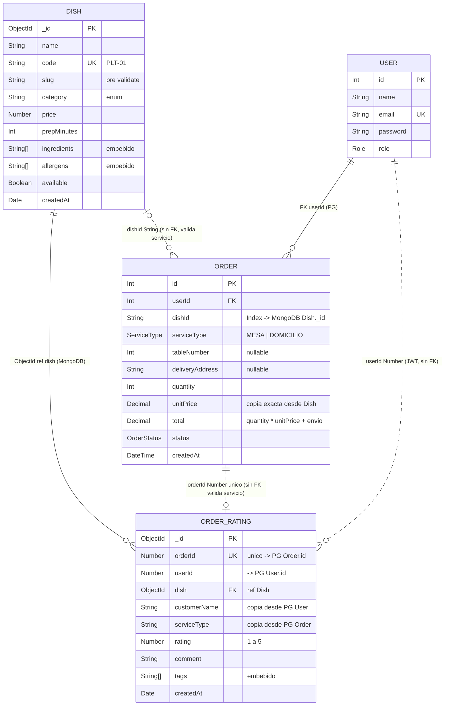

## 5. Referencias

| Referencia | Se guarda como | La garantiza | Se une con |
|---|---|---|---|
| `Order.userId` → `User.id` | `Int` con `FOREIGN KEY` en PostgreSQL | Motor **PostgreSQL** (`@relation` en Prisma) | `include` / `JOIN` SQL en PostgreSQL |
| `Order.dishId` → `Dish._id` | `String?` (24 caracteres hex) con `@@index([dishId])` en PostgreSQL | **Capa de servicio (`orderService`)**: valida `mongoose.isValidObjectId(dishId)` y `Dish.exists({ _id: dishId })` antes de crear el pedido | Consulta unida en aplicación: `Dish.find({ _id: { $in: dishIds } })` + `Map` (sin N+1) |
| `OrderRating.orderId` → `Order.id` | `Number` con índice único (`unique: true`) en MongoDB | **Capa de servicio (`orderRatingService`)**: consulta `prisma.order.findUnique` (`404` si no existe, `403` si `order.userId !== req.user.id`); índice único evita duplicados (`409` por `E11000`) | Generalmente no requiere unión al listar reseñas porque `serviceType` y `customerName` ya están copiados; si se requiere detalle financiero se consulta por `id` en Prisma |
| `OrderRating.userId` → `User.id` | `Number` en MongoDB (extraído siempre del token JWT) | **Middleware JWT + Prisma**: el token autentica el `userId` y el servicio verifica titularidad del pedido en PostgreSQL | `customerName` copiado en `OrderRating`; unión por lotes en Prisma solo si se requiere correo/perfil completo |
| `OrderRating.dish` → `Dish._id` | `ObjectId` con `ref: "Dish"` e índice `{ dish: 1, createdAt: -1 }` en MongoDB | **Capa de servicio**: se deriva directamente de `order.dishId` validado contra PostgreSQL y MongoDB | `populate("dish")` y `aggregate` en MongoDB |

## 6. Dato copiado entre bases (desnormalización)

- **Dato 1:** `customerName` (desde `User.name` en PostgreSQL) y `serviceType` (desde `Order.serviceType` en PostgreSQL) copiados en `OrderRating` (MongoDB).
  - **Por qué (operación del workload):** La lectura de calificaciones por plato ocurre ~2 500 veces/día y necesita mostrar quién calificó y si fue consumo en `MESA` o `DOMICILIO` en una sola consulta a MongoDB, sin golpear PostgreSQL.
  - **Costo:** Duplicación mínima (~40 bytes por reseña); si un usuario cambia su nombre posteriormente en PostgreSQL, las reseñas históricas conservarán el nombre que tenía al calificar (consistencia eventual aceptable).
- **Dato 2:** `unitPrice` (desde `Dish.price` en MongoDB) copiado en `Order` (PostgreSQL) para calcular y almacenar `total`.
  - **Por qué (operación del workload):** El menú cambia cada semana (incluyendo precios), pero cada pedido necesita un **total exacto e inmutable** para cobro y reportes financieros.
  - **Costo:** El servicio de pedidos debe leer el precio oficial desde MongoDB al crear cada orden (nunca confiar en el cliente) y el cambio semanal de precio en `Dish` no se propaga a pedidos anteriores (comportamiento deseado en contabilidad).

## 7. Endpoints

| Método y ruta | Base(s) | Respuestas posibles |
|---|---|---|
| `POST /api/auth/register` | PostgreSQL | `201` (creado), `400` (datos faltantes), `409` (email duplicado) |
| `POST /api/auth/login` | PostgreSQL | `200` (JWT), `401` (credenciales inválidas) |
| `POST /api/dishes` *(JWT)* | MongoDB | `201` (creado), `400` (validación Mongoose), `401`/`403` (JWT) |
| `GET /api/dishes?q=&fields=&sort=` | MongoDB | `200` (lista con regex, proyección y orden) |
| `GET /api/dishes/:id` | MongoDB | `200` (plato con virtual `menuSummary`), `400` (ObjectId inválido), `404` (no encontrado) |
| `PUT /api/dishes/:id` *(JWT)* | MongoDB | `200` (actualizado con `findById` + `save()`), `400` (validación/ID inválido), `404`, `401`/`403` |
| `DELETE /api/dishes/:id` *(JWT)* | MongoDB + PostgreSQL | `200` (eliminado + cascada de calificaciones), `400` (ID inválido), `404`, `409` (usado por pedidos en PG), `401`/`403` |
| `POST /api/orders` *(JWT)* | PostgreSQL + MongoDB | `201` (pedido con total exacto), `400` (datos o `dishId` inválido), `404` (plato no existe), `401`/`403` |
| `GET /api/orders` *(JWT)* | PostgreSQL + MongoDB | `200` (pedidos unidos con `Dish` vía `$in` + `Map`, sin N+1), `401`/`403` |
| `DELETE /api/orders/:id` *(JWT)* | PostgreSQL | `200` (eliminado), `400` (ID inválido), `403` (no es dueño), `404`, `401` |
| `POST /api/ratings` *(JWT)* | MongoDB + PostgreSQL | `201` (calificación creada con datos copiados), `400` (validación), `403` (pedido de otro usuario), `404` (pedido no existe), `409` (ya calificado `E11000`), `401` |
| `GET /api/ratings?dishId=` | MongoDB | `200` (lista con `populate("dish")`, orden `createdAt: -1` + `aggregate` de promedio y conteo), `400` (`dishId` inválido) |
| `DELETE /api/ratings/:id` *(JWT)* | MongoDB | `200` (eliminado), `400`, `403` (no es dueño), `404`, `401` |

## 8. Evidencias

### 8.1 Postman — Run Collection (`37/37` aserciones en verde)

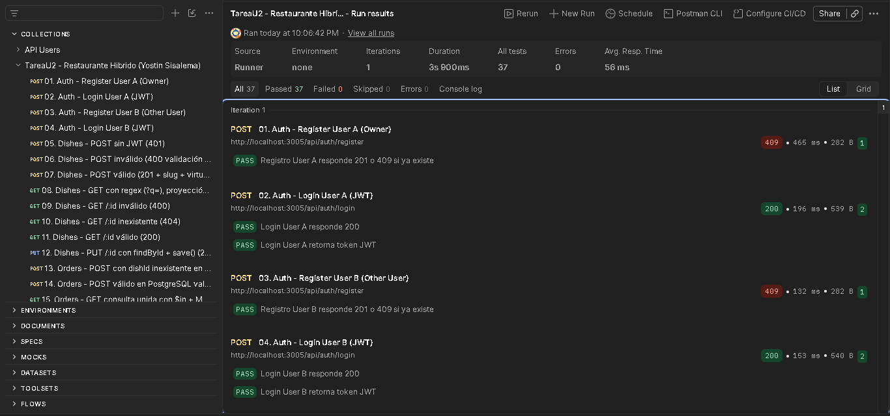

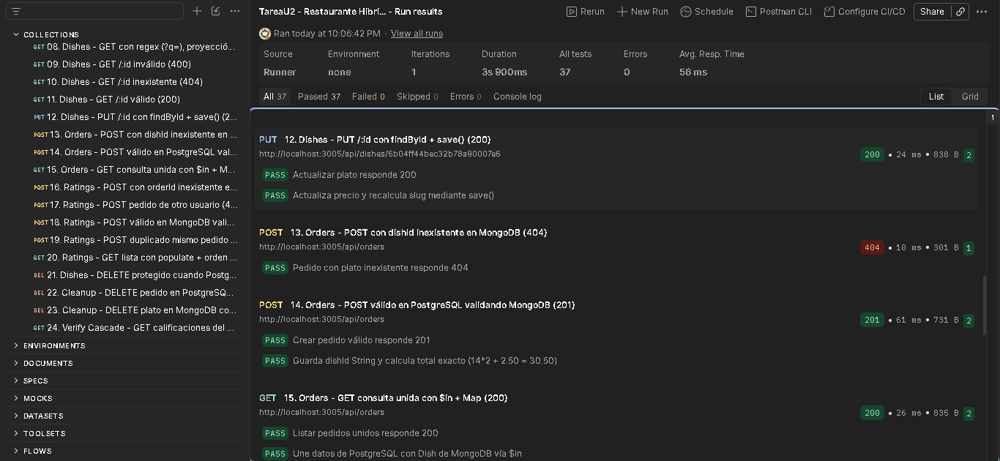

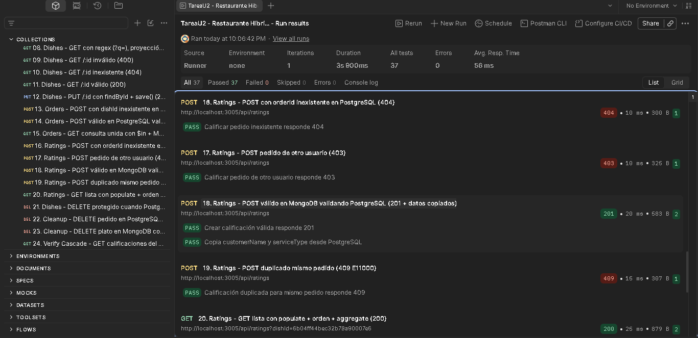

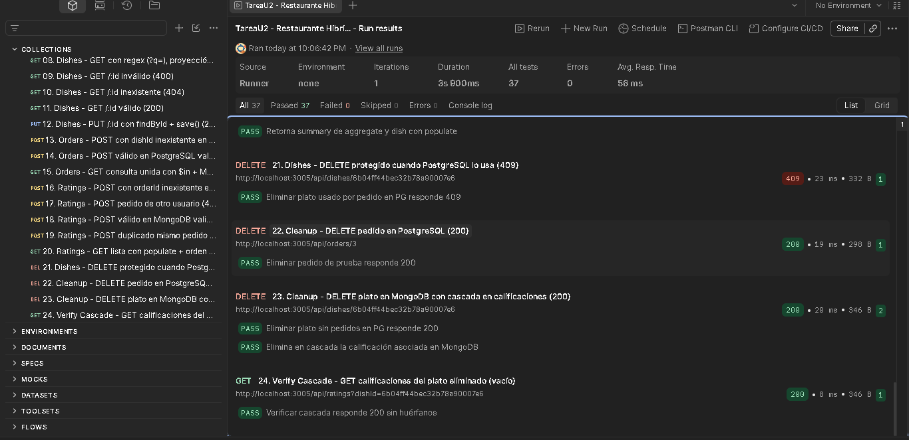

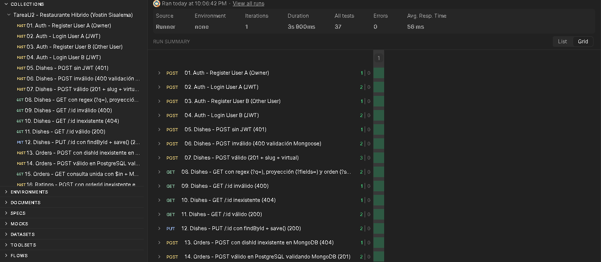

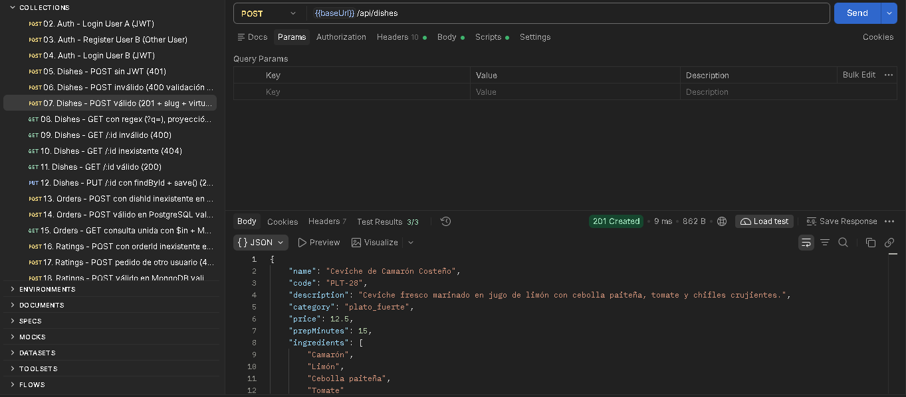

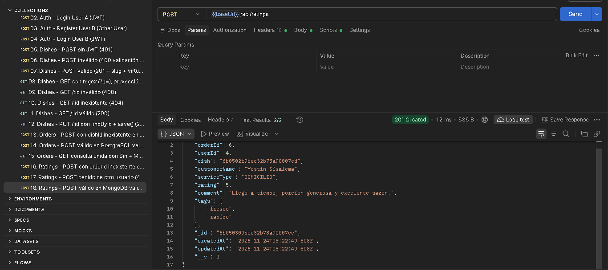

### 8.2 MongoDB Compass — Colecciones (`dishes` y `orderratings`)

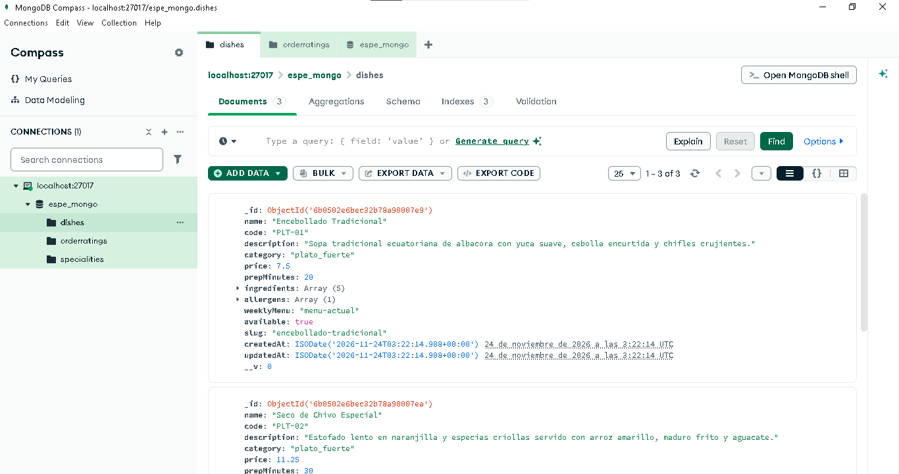

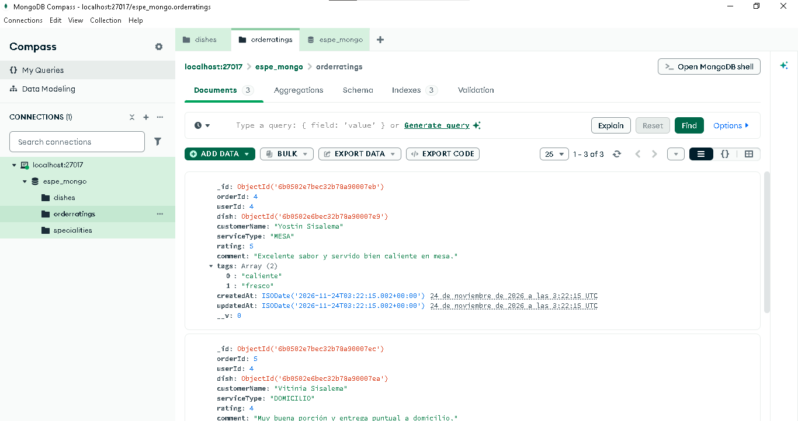

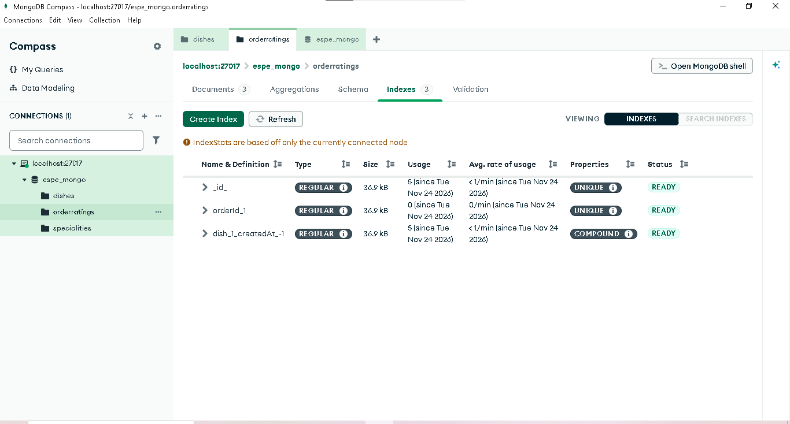

### 8.3 pgAdmin (PostgreSQL) — Tabla `Order` con columna `dishId` y ERD

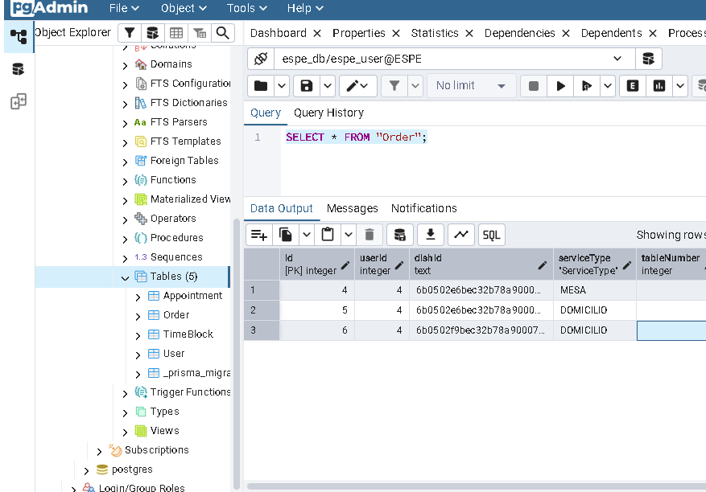

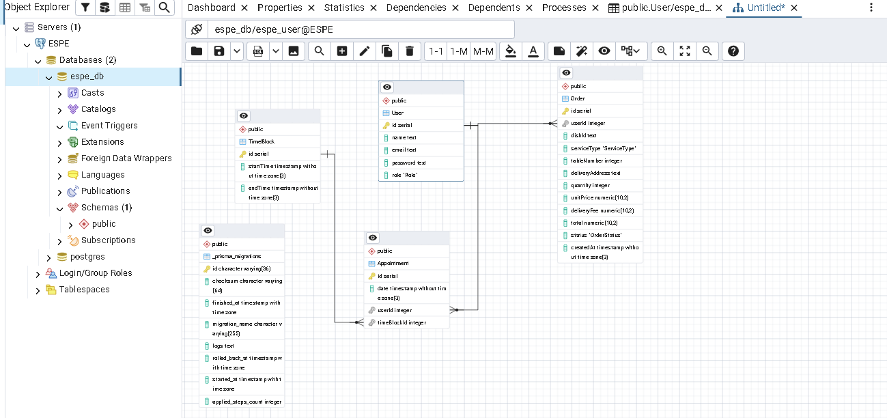

